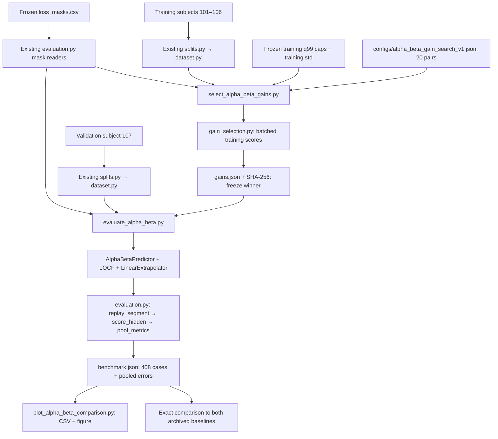
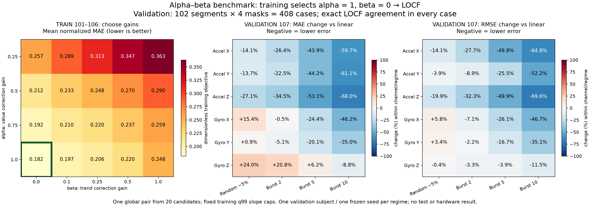

# Alpha–beta validation benchmark v1

**Result:** training selected **α = 1, β = 0**, the LOCF endpoint of the implemented family. On validation subject 107, all **408** selected-predictor replays and metrics exactly match the archived LOCF reference. This experiment did not establish an improvement over LOCF.

Date: **2026-10-23**. Phase 2 remains in progress. Subjects **108/109 were not loaded** by gain selection or validation. No neural model, uncertainty, transport, or hardware experiment was performed.

## Algorithm and interfaces

`src/packetheal/alpha_beta.py` provides `AlphaBetaPredictor(alpha, beta, max_delta_per_step, n_channels=6)`, with the existing `reset()` / `step(observation)` interface. One call represents one nominal 100 Hz sample step. `observation` is a finite six-channel received vector or `None` for a missing vector.

The predictor maintains a corrected value **s**, trend **d** in physical units per sample step, and the last correction index. On a real observation **z**, let Δ be the number of nominal steps since the preceding real observation:

```text
p = s + Δ d
r = z − p
s_new = p + α r
d_new = clip(d + β r / Δ, −caps, +caps)
```

Code uses equivalent convex combinations to reduce avoidable cancellation and skips unused endpoint arithmetic. Both corrections use the preceding state. During a gap, predict `s + h*d`, where h counts steps since the last correction; reconstructed outputs never perform measurement corrections. A returning real observation uses the full elapsed spacing.

Startup losses are UNAVAILABLE. The first received vector initializes s and zero trend, giving hold-last fallback until more information arrives. Received outputs always preserve the original vector, even when internal s is smoothed. Each segment/regime resets all state. Invalid inputs or non-finite arithmetic raise without advancing state. Slope caps constrain trend, not output magnitude or reconstruction error; no gap cutoff is implemented.

Two useful endpoint checks:

- **α=1, β=0:** s becomes the latest received vector and d stays zero → LOCF.
- **α=1, β=1:** s becomes the latest received vector and d becomes the capped two-received-point slope → the existing linear predictor.

## How the files connect



| File | Responsibility |
|---|---|
| `src/packetheal/alpha_beta.py` | Streaming predictor; has no file access or hidden ground truth. |
| `src/packetheal/gain_selection.py` | Scores all candidate states together for efficiency; hidden truth enters errors only. Chooses the minimum training objective. |
| `scripts/alpha_beta_common.py` | Checks frozen inputs, training normalization/caps, and source hashes shared by both runners. |
| `scripts/select_alpha_beta_gains.py` | Loads training segments/masks only, pools candidate errors, saves the selected gains and provenance. |
| `scripts/evaluate_alpha_beta.py` | Verifies independently pinned gains before loading validation; compares all three predictors on identical masks. |
| Existing `splits.py`, `dataset.py`, `evaluation.py` | Shared partition checks, segment loading, mask mapping, causal replay, scoring, and pooling; preserved unchanged. |
| `tests/test_alpha_beta.py`, `test_gain_selection.py`, `test_alpha_beta_validation.py` | Synthetic numerical, causality, selection, and frozen-parameter checks. |

## Training-only gain selection

The grid was declared before running selection: α ∈ **{0.25, 0.5, 0.75, 1}**, β ∈ **{0, 0.1, 0.25, 0.5, 1}**. One scalar pair is shared across all six channels and four loss regimes. Candidate order is ascending α outer / β inner; ties choose the first unrounded minimum.

For candidate k, channel c, and regime r:

```text
MAE[r,k,c] = pooled absolute hidden-error sum / hidden sample count
J[k] = mean across 4 regimes × 6 channels of MAE[r,k,c] / training_std[c]
```

Training standard deviations only scale the selection objective so acceleration and angular-rate units do not dominate by their numerical scale. Predictor inputs and reported MAE/RMSE remain in original physical units. This is parameter selection, not confidence/uncertainty calibration.

Selection used **834 segments / 1,928,693 samples / 3,336 segment-regime cases** from subjects 101–106. Hidden counts per regime: **95,600 / 96,002 / 97,260 / 99,380**. All candidates reused the existing frozen training q99 slope caps without refitting. No new masks were generated.

| Candidate | Training objective J (lower is better) |
|---|---:|
| **α=1, β=0 — selected (LOCF)** | **0.18162370661802477** |
| α=0.75, β=0 — next lowest | 0.1923992351648908 |
| α=1, β=0.1 — lowest with nonzero trend gain | 0.19663951048491612 |
| α=1, β=1 — capped linear endpoint | 0.24837371963732954 |

[calibration/gains.json](calibration/gains.json) preserves scores and per-channel/per-regime sums for all 20 candidates. Optimized candidate arithmetic matches the public streaming predictor in synthetic tests and on **24 training prefixes** (first 128 samples of the first segment of each training subject, under each regime, all 20 candidates). This is not a second full gain-search run. Independent arithmetic recomputed all saved candidate metrics/objectives and the winning index.

Gain artifact SHA-256: **`9eb9a8c44d7870d7d40d31dd6fe0e0a7cac876c38b2f4515fe81b99e690d4395`**. This checksum was supplied explicitly to validation, freezing the selected gains before validation measurements were loaded.

## Full validation result

Subject **107**: **102 segments / 285,488 samples / 408 cases** under the same four frozen masks as the earlier baselines. The first 20 samples of each segment are protected. Every hidden vector was reconstructed and scored; zero unavailable positions.

| Regime | Hidden sample vectors | Selected vs LOCF |
|---|---:|---|
| Random ~5% | 14,176 | Exact replay/metric agreement |
| Burst 2 | 14,226 | Exact replay/metric agreement |
| Burst 5 | 14,370 | Exact replay/metric agreement |
| Burst 10 | 14,660 | Exact replay/metric agreement |

These are alternative scenarios, not one combined loss trace. Scores pool error sums and counts across segments before computing each channel's MAE/RMSE; they do not average segment means.

Compared with capped linear extrapolation, the selected predictor has lower **MAE in 19/24** channel/regime combinations and lower **RMSE in 22/24**. Those counts are descriptive comparisons, not independent trials or significance tests. Acceleration-Z / burst-10 example: selected/LOCF **MAE 0.781423 m/s², RMSE 1.539781 m/s²**; linear **MAE 2.440729 m/s², RMSE 5.065408 m/s²**.



Left: the 20 training objectives; the green border marks the selected pair. Right: `100 * (selected_error / linear_error − 1)` within each channel/regime. Negative means lower error. The selected predictor's change relative to LOCF is exactly zero everywhere. Original-unit metrics for all three predictors and both relative comparisons are in [comparison.csv](comparison.csv).

## Verification and preserved evidence

- **116 automated software tests passed**: the previous 78 plus 18 predictor, 11 gain-scoring/selection, and 9 validation tests. These are distinct from dataset segments/cases. Full output: [software_tests.txt](software_tests.txt).
- For all 408 validation cases: repeated/reset replay is identical; received measurements and original arrays remain unchanged; replacing hidden truth with NaNs leaves outputs unchanged; changing future values leaves earlier outputs unchanged. The latter is a prefix perturbation check, not an exhaustive proof of every possible future change.
- Both baseline replays, case metadata, fingerprints, and pooled metrics exactly match their frozen archives. All input/source hashes remain unchanged during each run. Held-out recordings 108/109 are outside both runners' permitted loading paths.
- Independent `math.fsum` checks reconcile all three predictors' pooled absolute/squared sums and MAE/RMSE. All 408 selected fingerprints and metric dictionaries equal LOCF; the 24-row CSV matches JSON. See [verification.json](verification.json) for this saved-evidence check's scope.
- Selection, evaluation, and plotting runners refuse existing outputs; refusal checks preserved gain/report bytes.

The benchmark JSON, gain artifact/sidecar, CSV/figure, verification record, and software-test log are byte-identical copies of the original local outputs. `calibration/search.json` is an exact copy of the predeclared config. [artifacts.sha256](artifacts.sha256) checks archive files; [evaluated_sources.sha256](evaluated_sources.sha256) checks run sources, plotting code, and the tested suite from the repository root. Original source hashes in reports are preserved.

Prior linear work was committed and pushed as **`d1eadb1`** before implementation began. These alpha–beta runs record that HEAD with new files uncommitted; the HEAD alone does not contain the evaluated alpha–beta code. Source checksums identify the actual evaluated bytes. No new alpha–beta commit or push is implied by this archive.

## Reproduction

Recorded Python **3.12.3**, NumPy **2.4.4**, Matplotlib **3.11.0**; [requirements.txt](requirements.txt) contains minimal runtime pins rather than a complete environment lock. Original dataset files are external. Canonical frozen config, manifest, masks, preparation/normalization, q99 caps, and prior baseline archives must match recorded hashes.

```bash
sha256sum -c benchmarks/alpha_beta_validation_subject107_v1/evaluated_sources.sha256
(cd benchmarks/alpha_beta_validation_subject107_v1 && sha256sum -c artifacts.sha256)
(cd benchmarks/alpha_beta_validation_subject107_v1/calibration && sha256sum -c gains.json.sha256)
PYTHONPATH=src python3 -B -m unittest discover -s tests -v

# Optional: repeat the entire training-only search into a fresh path.
python3 -B scripts/select_alpha_beta_gains.py --output runs/alpha_beta_training_rerun/gains.json

# Reproduce validation with the ORIGINAL frozen gain bytes, without refitting.
python3 -B scripts/evaluate_alpha_beta.py --gains benchmarks/alpha_beta_validation_subject107_v1/calibration/gains.json --gains-sha256 9eb9a8c44d7870d7d40d31dd6fe0e0a7cac876c38b2f4515fe81b99e690d4395 --output runs/alpha_beta_validation_rerun.json

MPLCONFIGDIR=/tmp/packetheal-matplotlib python3 -B scripts/plot_alpha_beta_comparison.py --report benchmarks/alpha_beta_validation_subject107_v1/benchmark.json --gains benchmarks/alpha_beta_validation_subject107_v1/calibration/gains.json --output-dir runs/alpha_beta_plot_rerun
```

Choose fresh output paths for each rerun. A repeated fit should preserve selected gains, candidate scores, and input/source hashes; whole JSON bytes change with timestamps/Git metadata. The validation runner intentionally pins original gain provenance; use the original frozen artifact for this benchmark. Compare `per_segment` and `pooled_by_regime` for validation, rather than whole-JSON bytes. CSV values should agree; figure bytes can depend on plotting versions.

## Limits and next experiment

The result applies to this **20-pair global-gain grid, objective, initialization, fixed caps, and dataset definition**. It does not rule out other gains, channel-specific parameters, objectives, or estimator families. No validation retuning was performed. One validation subject and one frozen seed per regime do not establish cross-subject generalization or statistical significance. Retained high-dynamic recordings and synthetic-loss limitations remain unchanged. Long-outage behavior, uncertainty/abstention, and device resources are not validated.

**Next experiment:** review a small causal value/trend trace with nonzero gains before considering a separately approved extension. **PASS:** the hand calculation matches the predictor across received samples, consecutive losses, and recovery, and the learner can explain why the selected `(1,0)` endpoint equals LOCF. **FAIL:** resolve the state-update or evaluation misunderstanding before selecting another method. This benchmark does not authorize a new predictor or milestone.
