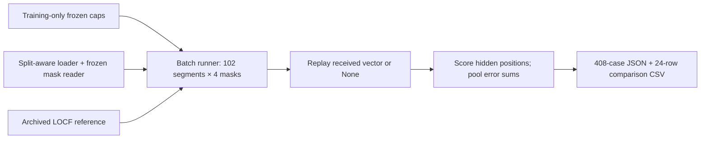
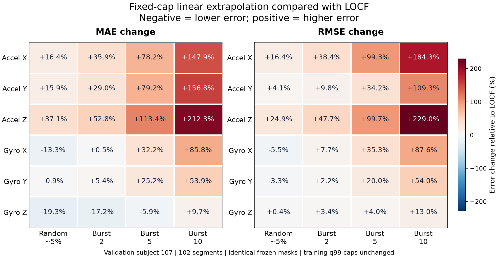
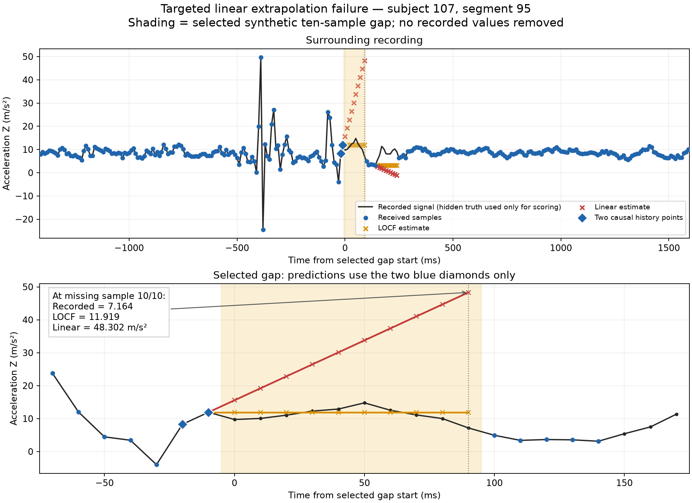

# Linear extrapolation benchmark — PAMAP2 validation subject 107, v1

**Experiment:** 2026-10-20. **Archive prepared and checked:** 2026-10-22.

**Scope:** Phase 2 classical causal baselines; desktop replay with synthetic sample loss. Git commit pending at archival time.

**Outcome:** All 408 comparison cases passed coverage, causality, repeatability, and provenance checks. With the fixed training-only q99 slope caps, linear extrapolation generally increased error relative to LOCF: lower MAE in **5/24** channel/regime combinations and lower RMSE in **2/24**. All six channels had higher MAE and RMSE during ten-sample bursts. A correct implementation does not imply an accurate predictor.

## Predictor and calibration

At a hidden sample index `t`, let `j < k < t` be the two latest **received** indices. For each channel:

```text
slope = clip((x[k] - x[j]) / (k - j), -cap, cap)
prediction[t] = x[k] + (t - k) * slope
```

- Calls advance nominal 100 Hz sample steps, including missing steps. The denominator accounts for losses between received samples; arbitrary arrival times are not modeled.
- Received measurements pass through unchanged and update real history. Estimates never become received history.
- Before any received sample, losses are `UNAVAILABLE` with NaN values. With one received sample, losses use LOCF. Every segment/regime starts with reset history.
- Only the slope is clipped. There is no output-magnitude bound, gap cutoff, confidence estimate, or abstention policy.

[LinearExtrapolator](../../src/packetheal/linear_extrapolation.py) implements the predictor. [Calibration](../../src/packetheal/calibration.py) pooled absolute adjacent-sample changes **within** eligible training segments, using NumPy `quantile(..., q=0.99, method="linear")`. No differences cross segment boundaries. No normalization or loss mask entered fitting.

Training subjects **101–106** supplied **834 segments / 1,928,693 samples / 1,927,859 adjacent pairs per channel**. The resulting caps were frozen before validation and were not retuned afterward.

| Channel | Frozen cap, rounded to six decimals | Cap unit |
|---|---:|---|
| Acceleration X | 5.229231 | m/s² per sample step |
| Acceleration Y | 6.210740 | m/s² per sample step |
| Acceleration Z | 4.254664 | m/s² per sample step |
| Gyroscope X | 1.274463 | rad/s per sample step |
| Gyroscope Y | 0.414809 | rad/s per sample step |
| Gyroscope Z | 0.589966 | rad/s per sample step |

[calibration/slope_limits.json](calibration/slope_limits.json) preserves full precision, training counts, quantile convention, and fitting provenance. SHA-256: `316cc1f1d0e95446329f1f689512703a146f6d07ad00bf463649ad705e13f502`. These are empirical training-change quantiles, not physical validity limits or confidence bounds.

## Dataset, shared architecture, and evaluation

- PAMAP2 **Protocol**, validation subject **107**, wrist acceleration XYZ and gyroscope XYZ: zero-based original columns `[4, 5, 6, 10, 11, 12]`.
- **102 eligible segments / 285,488 samples**, nominal **100 Hz**; frozen finite-value, activity-consistency, timestamp-continuity, and minimum-length rules.
- Four frozen synthetic loss regimes, preparation seed **42**, first **20 samples** protected in each segment. Each hidden position hides all six channels together. Random loss can contain consecutive missing samples.
- **408 segment/regime cases**. Regimes are alternative scenarios on the same recording, not four independent recordings. No new filtering, spike removal, normalization, masks, or model selection was applied.
- Test subjects **108/109** remained held out. This validation is distinct from a final-test or hardware result.

The [batch runner](../../scripts/evaluate_linear_extrapolation_batch.py) reuses the [single-segment verification helpers](../../scripts/evaluate_linear_extrapolation.py), [split-aware loader](../../src/packetheal/splits.py), [dataset loader](../../src/packetheal/dataset.py), and [mask/replay/scoring utilities](../../src/packetheal/evaluation.py). LOCF and linear share the loading, masks, replay contract, statuses, and metrics; their causal predictor logic differs.



Hidden reference measurements remain available to the **scorer only**, never to the predictor. The runner verifies every LOCF replay against the [existing LOCF benchmark](../locf_validation_subject107_v1/README.md), including its full output/status/loss-age fingerprint and metrics. Each linear case is replayed twice on the same reset predictor object, then checked with hidden truth replaced by NaNs and with future values changed. Received values and original arrays must remain unchanged.

| Regime | Hidden / scored positions | Actual missing fraction | Longest missing run |
|---|---:|---:|---:|
| Random ~5% | 14,176 | 4.9655% | 4 |
| Burst 2 | 14,226 | 4.9830% | 2 |
| Burst 5 | 14,370 | 5.0335% | 5 |
| Burst 10 | 14,660 | 5.1351% | 10 |

All hidden positions were reconstructed and scored; **zero unavailable** outputs and **100% reconstruction availability** in each regime. Availability does not measure accuracy or uncertainty coverage.

For each regime/channel, with `e = prediction - recorded value`, `MAE = sum(abs(e))/N` and `RMSE = sqrt(sum(e²)/N)`. Pool absolute/squared error sums and scored counts across segments **before dividing**. Averaging segment MAEs or RMSEs gives incorrect weighting. Acceleration and gyroscope errors remain in their separate physical units.

## Results

The following linear-only tables are rounded to six decimals. [comparison.csv](comparison.csv) preserves both predictors' MAE/RMSE and relative changes at recorded precision; [benchmark.json](benchmark.json) also contains all case error sums, segment metadata, and fingerprints.

### Linear acceleration — m/s²

| Regime | X MAE | X RMSE | Y MAE | Y RMSE | Z MAE | Z RMSE |
|---|---:|---:|---:|---:|---:|---:|
| Random ~5% | 0.618444 | 1.847434 | 0.897192 | 4.251149 | 0.629194 | 1.615530 |
| Burst 2 | 0.878723 | 2.372402 | 1.274585 | 5.487708 | 0.803528 | 1.994527 |
| Burst 5 | 1.544285 | 3.683350 | 2.148246 | 6.741775 | 1.408840 | 3.117913 |
| Burst 10 | 2.788341 | 6.301203 | 3.628552 | 8.469140 | 2.440729 | 5.065408 |

### Linear gyroscope — rad/s

| Regime | X MAE | X RMSE | Y MAE | Y RMSE | Z MAE | Z RMSE |
|---|---:|---:|---:|---:|---:|---:|
| Random ~5% | 0.114105 | 0.313090 | 0.052849 | 0.090481 | 0.057416 | 0.203553 |
| Burst 2 | 0.179269 | 0.511791 | 0.071783 | 0.128077 | 0.078181 | 0.246248 |
| Burst 5 | 0.365615 | 0.825972 | 0.138100 | 0.236620 | 0.148349 | 0.340603 |
| Burst 10 | 0.711469 | 1.566609 | 0.264564 | 0.462649 | 0.292132 | 0.600004 |

### Comparison with LOCF

`Relative change (%) = 100 * (linear error / LOCF error - 1)`. Negative means lower error. Each comparison is within the same channel and regime; no averaging across acceleration/gyroscope units is implied.

| MAE change | Random ~5% | Burst 2 | Burst 5 | Burst 10 |
|---|---:|---:|---:|---:|
| Acceleration X | +16.39% | +35.94% | +78.18% | +147.91% |
| Acceleration Y | +15.86% | +28.97% | +79.23% | +156.83% |
| Acceleration Z | +37.12% | +52.77% | +113.35% | +212.34% |
| Gyroscope X | -13.35% | +0.47% | +32.21% | +85.77% |
| Gyroscope Y | -0.93% | +5.36% | +25.18% | +53.87% |
| Gyroscope Z | -19.33% | -17.23% | -5.85% | +9.70% |



- All acceleration channels had higher MAE and RMSE in every regime.
- All three gyroscope MAEs were lower under random loss. Gyroscope-Z MAE was also lower for bursts 2/5, while its RMSE was higher in every regime.
- Only random-loss gyroscope X/Y had lower RMSE. Lower MAE with higher RMSE can occur when typical absolute errors improve while large errors contribute more squared error; this aggregate comparison does not establish the full error distribution.
- All six channels were worse on both metrics under burst 10. Different regimes hide different positions, so the comparison does not isolate gap length as the only cause.
- The 5/24 MAE and 2/24 RMSE counts describe pooled channel/regime combinations, not independent statistical trials or significance tests. No universal winner or application acceptance threshold is established.

## Targeted failure and numerical explanation

Select the burst-10 **segment** with the largest acceleration-Z excess squared-error sum (`linear - LOCF`); inside it, select the hidden **sample** with the largest excess squared error. Ties favor the earliest segment/sample. This deliberately chooses a failure for diagnosis and is not a representative accuracy estimate.

Selected **segment 95**, with 1,140 hidden positions and excess acceleration-Z squared-error sum **104,419.23365556677 (m/s²)²**. At original row **292983**, timestamp **2935.74 s**, missing sample **10/10**:

| Quantity | Value |
|---|---:|
| Previous received, original row 292972 | 8.28028 m/s² |
| Last received, original row 292973 | 11.9186 m/s² |
| Received spacing | 1 sample step |
| Slope | 3.63832 m/s² per step |
| Frozen acceleration-Z cap | 4.254664447999997 m/s² per step |
| Horizon from last received sample | 10 steps |
| Linear estimate: `11.9186 + 10 * 3.63832` | 48.3018 m/s² |
| Hidden recorded value | 7.16394 m/s² |
| LOCF estimate / absolute error | 11.9186 / 4.75466 m/s² |
| Linear absolute error | 41.13786 m/s² |

The slope is below the cap, so clipping does not activate. The predictor continues the received rise while the recorded signal levels and falls. A cap limits slope size; it does not guarantee that a recent trend persists. Both full-segment replay fingerprints and all metrics matched the saved case, and three original rows were checked across all six channels/timestamps. Independent decimal arithmetic reproduced the prediction/errors.



[diagnostics/event.json](diagnostics/event.json) records the selection, causal history, cap, error, and verification. [diagnostics/sample_trace.csv](diagnostics/sample_trace.csv) contains the 301-row surrounding trace. Historical absolute paths in the event are retained as recorded. This trace does not explain every error, quantify prevalence, or distinguish physical motion from sensor/data artifacts.

## Preserved evidence and verification

Ten evidence files were copied **byte for byte** from the original local outputs, including the full report, first-segment smoke report, caps/sidecar, comparison CSV/figure, previous verification record, and three diagnostic artifacts. Original dates, paths, and Git metadata were not rewritten.

- [artifacts.sha256](artifacts.sha256): checks every archive file except the checksum list itself, including this summary and the archive-verification record.
- [evaluated_sources.sha256](evaluated_sources.sha256): checks 12 evaluated/diagnostic source files, with paths relative to the repository root. Source files remain in the repository's normal locations.
- [verification.json](verification.json): original saved-case and pooled-arithmetic checks from 2026-10-20, including report/CSV/figure hashes. Its scope does not claim a second independent implementation of every prediction.
- [archive_verification.json](archive_verification.json): archival copy/provenance checks, all-case pooling reconciliation, unit-test result, and selected-case reproduction performed on 2026-10-22.
- [smoke_segment0_random_5pct.json](smoke_segment0_random_5pct.json): original 221-hidden-position check; the first batch case has identical metrics and replay fingerprint.

The original batch and calibration record HEAD `0c34de22353b182771cfc38f3f274126592b76d3` and an uncommitted working-tree state. That commit alone does not contain the evaluated linear implementation. The archived reports and source hashes preserve the evaluated bytes' identity; committing the reviewed source and evidence remains a separate action.

**78 automated tests** passed at evaluation and again during archival. They cover predictor startup/fallback, consecutive/long losses, recovery using real history, reset, caps, ownership, invalid inputs/overflow, training-only calibration, mask/split enforcement, hidden/future independence, scoring, weighted pooling, and batch completeness. These software test cases are distinct from the 408 dataset cases. Archived-case checks independently reconcile pooled sums using `math.fsum`; the selected segment is replayed from original subject-107 data during archival. The complete 408-case dataset replay was performed on 2026-10-20 and was not repeated during archival.

## Reproduction

Recorded Python **3.12.3**, NumPy **2.4.4**, and plotting Matplotlib **3.11.0**. [requirements.txt](requirements.txt) supplies minimal runtime pins, not a full historical environment lock. Dataset files are external to the archive. The existing canonical frozen split, manifest, masks, preparation artifacts, and `data/processed/linear_extrapolation_v1/slope_limits.json` must match recorded hashes; the archived caps are an exact reference copy. Do not refit or retune caps to reproduce this benchmark.

From the repository root:

```bash
sha256sum -c benchmarks/linear_validation_subject107_v1/evaluated_sources.sha256
(cd benchmarks/linear_validation_subject107_v1 && sha256sum -c artifacts.sha256)
(cd benchmarks/linear_validation_subject107_v1/calibration && sha256sum -c slope_limits.json.sha256)
PYTHONPATH=src python3 -B -m unittest discover -s tests -v
MPLCONFIGDIR=/tmp/packetheal-matplotlib python3 -B scripts/plot_linear_failure.py --report benchmarks/linear_validation_subject107_v1/benchmark.json --output-dir runs/linear_archive_diagnostic_rerun
```

Choose a new output folder on each run; overwrites are refused. Expected event: segment 95, row 292983, linear **48.3018**, recorded **7.16394**, absolute error **41.13786 m/s²**. Verify both replay fingerprints and metrics. Fresh event JSON timestamps/paths may differ; trace values must agree. Plot bytes can depend on the plotting environment.

To repeat the complete validation comparison, explicitly run:

```bash
python3 -B scripts/evaluate_linear_extrapolation_batch.py --output runs/linear_validation_subject107_all_regimes_rerun.json
```

Compare `per_segment` and `pooled_by_regime` with the archive; do not require identical whole-JSON bytes because creation/Git metadata changes. The diagnostic intentionally pins the **original archived report hash** and verifies its source/input versions. Use the archived report for that command. If evaluated source bytes change, preserve this historical version or record a separately approved benchmark instead of silently bypassing checks.

## Limits and next experiment

Evidence covers one validation subject and one frozen seed per regime. There are no final-test, cross-subject, multi-seed, significance, or confidence-interval results. Systematic loss-age, activity, normalized-error, and transient analyses remain pending. No real transport timing, uncertainty/abstention, firmware, latency, memory, power, or safety performance was measured. Phase 2 remains in progress.

Next experiment, after learner review and separate design approval: define the next classical causal predictor before implementation. **PASS** for its initial synthetic experiment requires correct startup/reset, constant and ramp behavior under the approved policy, received-history handling through losses, and hidden/future independence. Otherwise **FAIL** and fix correctness before using the frozen subject-107 masks. This archive does not authorize a new predictor or milestone.
