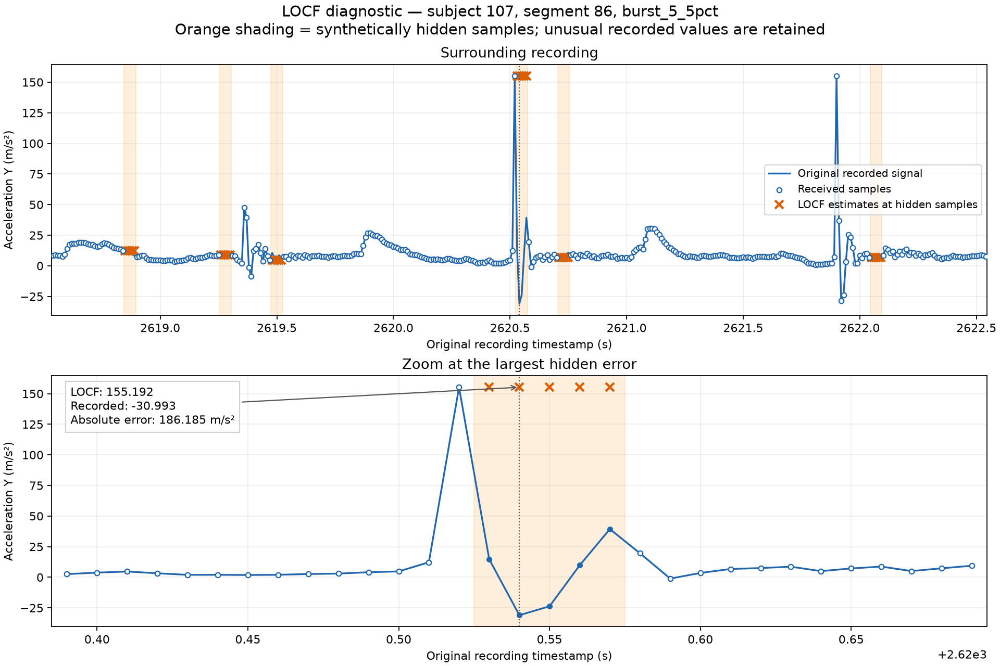
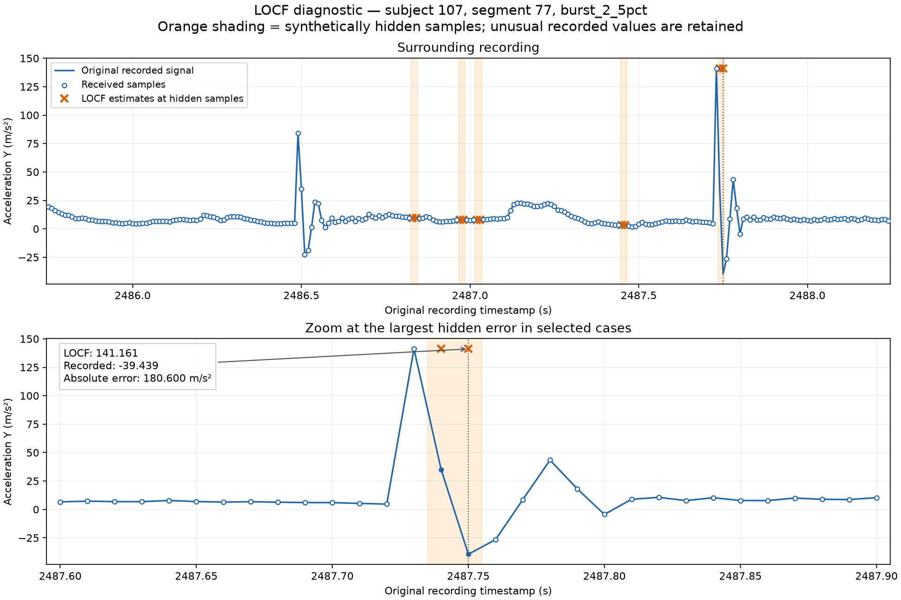

# LOCF benchmark — PAMAP2 validation subject 107, v1

**Documented:** 2026-10-19. **Benchmark run:** 2026-10-17.

**Scope:** Phase 2 classical baseline; desktop replay with synthetic sample loss.

**Outcome:** LOCF implemented and evaluated on all 102 eligible validation segments and four frozen loss regimes. Correctness/repeatability checks passed. Reconstruction quality has no predefined acceptance threshold, and this is not a final-test or embedded validation result.

## What LOCF does

Last Observation Carried Forward keeps the most recent received six-channel measurement. A hidden sample receives that vector as its estimate. Consecutive losses keep the same vector and increase the missing-run counter; reconstructed values never become new measurements.

- Received sample: pass through unchanged, mark `MEASURED`, and replace stored history.
- Missing sample after initialization: hold the last received vector and mark `RECONSTRUCTED`.
- Missing sample before the first received sample: output NaNs and mark `UNAVAILABLE`.
- Every segment/regime replay starts with reset history.
- There is no fitting, normalization, clipping, confidence estimate, or maximum supported gap cutoff in this baseline. Holding through a long outage does not establish reliability.

For a hidden index t, the estimate is the original vector at the latest received index k < t. Future measurements and hidden reference values are excluded from the predictor's input.

## Dataset and experiment definition

- PAMAP2 **Protocol**, validation subject **107** only: **102 eligible segments / 285,488 samples**. These are eligible samples, not every row of the original recording.
- Nominal rate: **100 Hz**. Selected original zero-based columns: `[4, 5, 6, 10, 11, 12]`.
- Channel order: acceleration X/Y/Z in **m/s²**, then gyroscope X/Y/Z in **rad/s**.
- Segments follow the frozen finite-value, activity-consistency, timestamp-continuity, and minimum-length rules. No new filtering or spike removal was applied.
- Frozen loss positions use preparation seed **42** and protect the first **20 samples** of each segment. Losses hide all six channels together.
- **408 segment/regime cases**; each was replayed twice. Total eligible samples remain 285,488; the four regimes are alternative scenarios, not four independent recordings.
- No predictor fitting or parameter selection was performed. Subjects 108 and 109 were not evaluated.

| Regime | Hidden / scored samples | Actual missing fraction | Longest missing run |
|---|---:|---:|---:|
| Random ~5% | 14,176 | 4.9655% | 4 |
| Burst 2 | 14,226 | 4.9830% | 2 |
| Burst 5 | 14,370 | 5.0335% | 5 |
| Burst 10 | 14,660 | 5.1351% | 10 |

Actual fractions above use all 285,488 eligible samples as the denominator, including protected warm-up samples. The random mask can contain adjacent losses; it does not guarantee isolated gaps. Masks differ across regimes and are not nested. Future predictors must use the identical masks within each regime.

## Data flow and implementation

1. [Single-segment runner](../../scripts/evaluate_locf.py) or [batch runner](../../scripts/evaluate_locf_batch.py) checks preparation artifact hashes and selects the experiment.
2. [Split-aware loader](../../src/packetheal/splits.py) checks partition membership, then [dataset loader](../../src/packetheal/dataset.py) reads original timestamps and measurements from the eligible segment.
3. [Evaluation utilities](../../src/packetheal/evaluation.py) load frozen masks. Original one-based recording rows become local indices using `missing_original_row - segment_start_row`.
4. Replay passes only the current received vector or `None` to [LOCF](../../src/packetheal/baselines.py). Ground truth remains separate and unchanged.
5. Evaluation scores hidden reconstructed positions. Unavailable outputs are counted explicitly.

The batch reader scans masks once, loads each segment using the existing split-aware interface, and resets LOCF for every case. Replay preserves order without sleeping for the 10 ms sample period; no on-device timing measurement is implied.

## Metric definition

For one regime and channel, let H contain its scored hidden positions, and let `e = reconstruction - original measurement`:

- `MAE = sum(abs(e)) / len(H)`
- `RMSE = sqrt(sum(e²) / len(H))`

Pooled metrics sum absolute errors, squared errors, and scored counts across segments before dividing. They are **not** unweighted averages of segment MAEs or RMSEs. Each scored hidden sample receives equal weight. Measured positions do not enter the errors. Acceleration and angular-rate errors are reported separately in their original units.

All hidden positions were reconstructed and scored; unavailable count was **0** and reconstruction coverage was **100%** in every regime. That coverage describes output availability, not confidence or accuracy.

## Results

Tables are rounded to six decimal places. [Full JSON](benchmark.json) and [pooled CSV](pooled_metrics.csv) retain recorded precision and error sums. JSON also contains all 408 per-segment/regime records, original segment metadata, and replay fingerprints.

### Acceleration — m/s²

| Regime | X MAE | X RMSE | Y MAE | Y RMSE | Z MAE | Z RMSE |
|---|---:|---:|---:|---:|---:|---:|
| Random ~5% | 0.531344 | 1.587578 | 0.774399 | 4.084317 | 0.458850 | 1.293728 |
| Burst 2 | 0.646393 | 1.714125 | 0.988256 | 4.999073 | 0.525973 | 1.350553 |
| Burst 5 | 0.866698 | 1.848494 | 1.198578 | 5.021965 | 0.660331 | 1.561166 |
| Burst 10 | 1.124725 | 2.216374 | 1.412816 | 4.046108 | 0.781423 | 1.539781 |

### Gyroscope — rad/s

| Regime | X MAE | X RMSE | Y MAE | Y RMSE | Z MAE | Z RMSE |
|---|---:|---:|---:|---:|---:|---:|
| Random ~5% | 0.131683 | 0.331255 | 0.053344 | 0.093572 | 0.071171 | 0.202770 |
| Burst 2 | 0.178431 | 0.475322 | 0.068131 | 0.125270 | 0.094454 | 0.238231 |
| Burst 5 | 0.276535 | 0.610480 | 0.110319 | 0.197124 | 0.157572 | 0.327374 |
| Burst 10 | 0.382991 | 0.835081 | 0.171940 | 0.300375 | 0.266312 | 0.531208 |

## Interpretation

- Pooled MAE increased on all six channels from random loss through two-, five-, and ten-sample burst scenarios in this run.
- RMSE was not monotonic for every channel. For example, acceleration-Y RMSE was 5.021965 m/s² for burst 5 and 4.046108 m/s² for burst 10. Different hidden positions and the influence of large errors prevent interpreting this as proof that longer gaps are easier.
- Segment 77 contributed approximately **26.13%** of acceleration-Y squared error under burst 2. A pooled average alone can conceal large differences between recording sections.
- The initial segment-0 random-loss result was only a smoke check. Full-subject errors are larger, so that initial segment was not a sufficient benchmark by itself.
- These values establish a reproducible comparison reference. No application error budget, accuracy percentage, superiority over another predictor, or deployment readiness is established.

## Two diagnostic events

Both checks compared replay outputs with the saved batch fingerprints and traced the selected values to the original recording. Segment numbers below are zero-based loader indices.

| Selection | Original row / time | Last received = LOCF (m/s²) | Hidden recorded value (m/s²) | Absolute error (m/s²) |
|---|---|---:|---:|---:|
| Segment 86, burst 5: largest acceleration-Y error across all 408 cases | 261463 / 2620.54 s | 155.1920 | -30.9929 | 186.1849 |
| Segment 77, burst 2: largest acceleration-Y error in that selected case | 248184 / 2487.75 s | 141.1610 | -39.4387 | 180.5997 |

In both events, the selected hidden position was the second consecutive loss. LOCF correctly held a received spike while the recorded signal changed sharply. The plots do **not** establish whether those spikes represent physical motion or sensor/data artifacts. Original values and masks were retained.





The `diagnostics/` folder includes each historical event JSON and sample-trace CSV. Archived CSV line endings are normalized to LF; parsed values are unchanged. Historical absolute paths and diagnostic-script hashes are retained as recorded. The current plotting tool reproduces the event values; plot styling and metadata can differ from earlier diagnostic revisions.

## Verification and practical limits

**Verified evidence:**

- **29 automated tests** passed for startup, isolated/consecutive/long losses, recovery, reset, array ownership, received-value validation, mask mapping, split enforcement, hidden/future perturbations, metric arithmetic, coverage, and weighted pooling.
- All **408 cases** replayed twice with identical output arrays, statuses, loss ages, and metrics.
- Original arrays and received samples remained unchanged; all hidden counts matched the preparation report.
- All recorded MAE/RMSE values were finite. Independent arithmetic using saved segment error sums agreed with the pooled results.
- Segment 0 matched the earlier single-segment report within floating-point precision.
- Frozen artifact/recording hashes were unchanged after the batch. The first diagnostic matched all 408 fingerprints; the second matched its one selected case.

**Unverified or incomplete:**

- Single validation subject and one frozen seed per regime; no final-test, cross-subject, or multi-seed generalization result and no confidence intervals.
- Per-segment metrics are available, but no systematic per-activity, transient-threshold, normalized-error, or loss-age-conditioned analysis has been completed. Two diagnostic plots do not establish signal quality across the dataset.
- No real transport faults, arrival-time behavior, firmware, latency, power, memory, uncertainty calibration, or safety performance measured.
- Other causal baselines remain unimplemented. Large errors alone do not show that another method will perform better.
- The original run recorded Python **3.12.3** and NumPy **2.4.4**; a full environment lock was not captured. The minimal reproduction pins below were captured when documenting the benchmark and are not a historical full-environment lock.

## Provenance and reproduction

The original batch JSON records HEAD `fdca14d95b9af5fd5e5907043aa8704d2918b518` because the evaluation code was untracked during that run. Those source bytes were subsequently committed as **`8c5ca42050aa2fa2108b94687b97982d6154f671`**. All six recorded source hashes were checked against that commit and match. The original metadata has not been rewritten to imply the code was committed at execution time.

The JSON contains split/manifest/mask/normalization/preparation hashes, the subject-107 recording hash, source hashes, runtime versions, seed, and run date. [artifacts.sha256](artifacts.sha256) verifies the benchmark evidence copied into this folder. [requirements.txt](requirements.txt) pins NumPy and the current plotting dependency; use Python 3.12.3 to match the recorded Python version.

From the repository root, using an environment with these dependencies and the original local dataset:

```bash
PYTHONPATH=src python3 -B -m unittest discover -s tests -v
python3 -B scripts/evaluate_locf_batch.py --output runs/locf_validation_subject107_rerun.json
MPLCONFIGDIR=/tmp/packetheal-matplotlib python3 -B scripts/plot_locf_error.py --report benchmarks/locf_validation_subject107_v1/benchmark.json --output-dir runs/locf_diagnostic_rerun
MPLCONFIGDIR=/tmp/packetheal-matplotlib python3 -B scripts/plot_locf_error.py --report benchmarks/locf_validation_subject107_v1/benchmark.json --segment-index 77 --regime burst_2_5pct --output-dir runs/locf_diagnostic_segment77_rerun
```

Choose new output paths on repeat runs; the tools refuse overwrites. Compare metrics and replay fingerprints rather than entire JSON bytes because date/Git metadata can differ. If evaluated source hashes change, the diagnostic intentionally refuses replay against this historical report; use commit `8c5ca42` for the evaluated source or create a new versioned benchmark after an approved change.

Verify the archived evidence from this benchmark directory:

```bash
sha256sum -c artifacts.sha256
```

## Next experiment

Review and approve the causal linear-extrapolation design before implementation. Then test a synthetic constant-speed ramp, startup, consecutive losses, reset, and hidden/future independence. **PASS** requires the expected predictions under the approved slope policy and preserved causal boundaries; otherwise **FAIL** and correct the implementation before comparing it with LOCF on identical validation masks. Phase 2 remains in progress.
