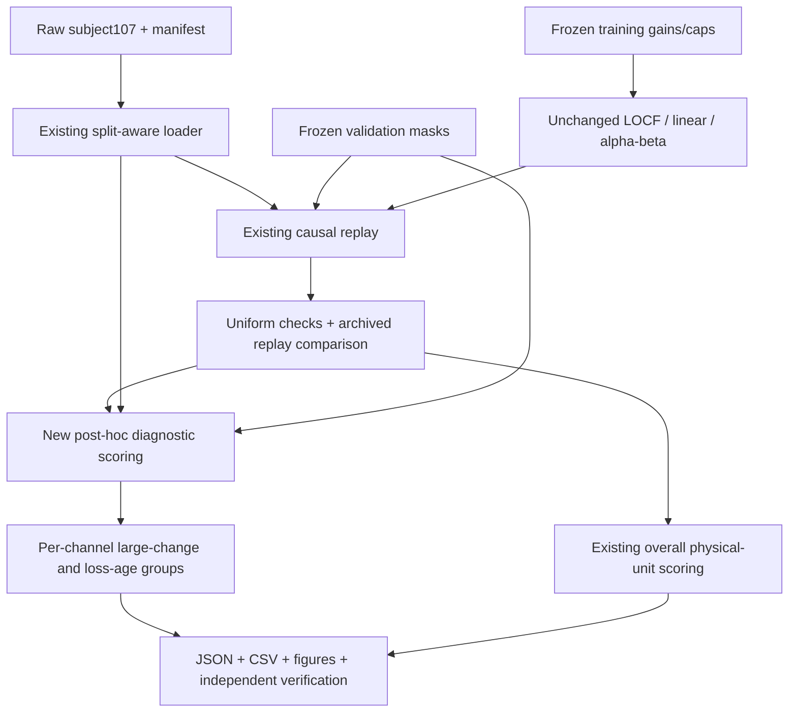
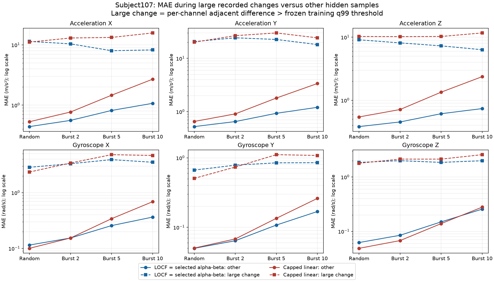
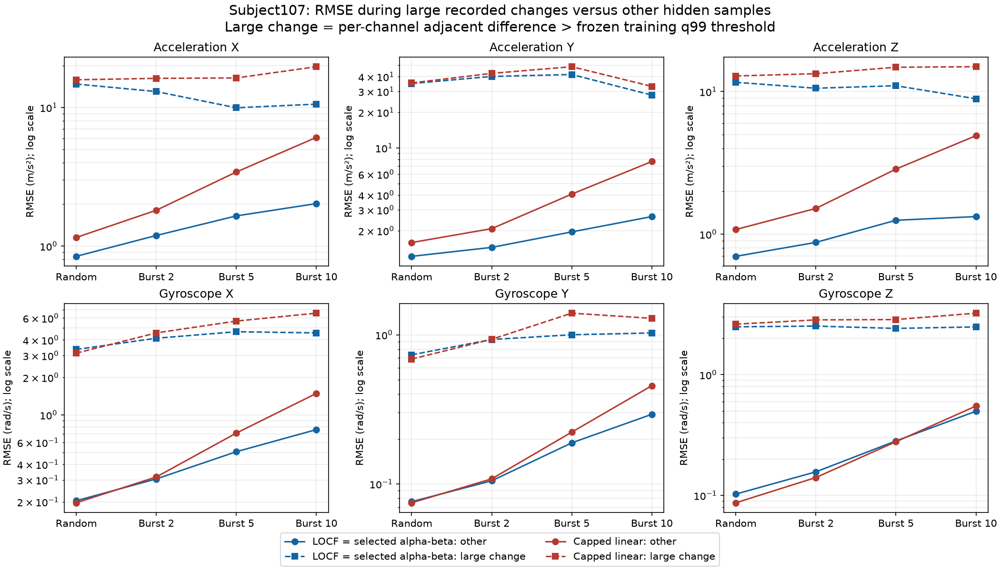
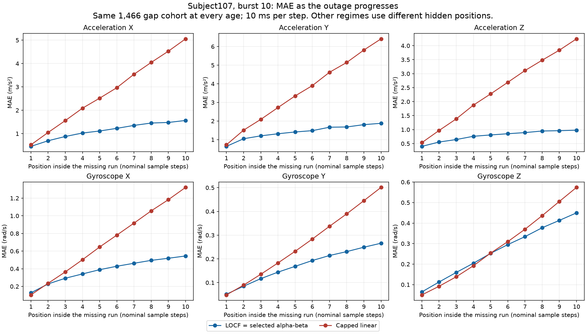
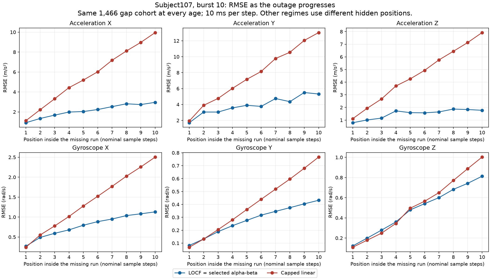

# Phase 2 — classical causal validation analysis v1

**Verified:** subject **107 only**, **102 segments / 285,488 samples / 408 segment-regime cases / 1,224 algorithm cases**. Every full replay fingerprint and overall metric matches the frozen combined benchmark. **144 software tests passed.** The benchmark ran on 2026-10-23; source/result identities, tests and independent raw-case verification were rechecked on 2026-10-24 after a disk interruption. No held-out recording 108/109 was opened. No fitting, new masks, NN, firmware, or device measurement was performed.

This completes the requested validation analysis for learner review. Phase 2 acceptance and any Phase 3 design remain separate decisions. New source/evidence are uncommitted; run HEAD is `c869b10`, with actual evaluated source bytes identified by hashes.

## Common experiment and prediction contract

Use the existing six-channel wrist IMU data in original units at nominal 100 Hz. The same frozen mask hides whole vectors for every algorithm. Keep segments separate, reset every segment/regime, and preserve the first 20 received samples. Never regenerate masks or change retained high-dynamic measurements.

LOCF holds the last received vector. Linear uses the last two received vectors and their nominal-index spacing, clipped by frozen training q99 per-step slope caps. Alpha-beta corrects internal value/trend only on real observations, with elapsed steps across gaps. Received outputs pass through unchanged; estimates never become real measurements or trigger measurement correction. Startup losses are UNAVAILABLE. There is no outage cutoff, output-magnitude bound, or confidence estimate.

Training selected **alpha=1, beta=0**, which exactly equals LOCF. Three families were evaluated but produced only two distinct selected prediction behaviors. No illustrative nonzero gain was substituted after validation. Frozen gain hash: `9eb9a8c44d7870d7d40d31dd6fe0e0a7cac876c38b2f4515fe81b99e690d4395`; cap hash: `316cc1f1d0e95446329f1f689512703a146f6d07ad00bf463649ad705e13f502`. Both were fitted/selected using subjects 101–106 only; this evaluation opens no training recordings.

Per channel/regime, pool absolute/squared hidden-error sums and scored counts: **MAE = sum_abs / N**, **RMSE = sqrt(sum_sq / N)**. Do not average segment means/RMSEs. Received positions are excluded; unavailable counts and coverage remain explicit. All current hidden positions were scored. Units are m/s² for acceleration and rad/s for gyroscope; no unlabeled cross-unit aggregate is reported.

## Files and architecture



- `src/packetheal/diagnostics.py`: per-channel recorded-change flags, independent loss ages/run lengths, stratified sums/counts, pooling and reconciliation. Labels never enter predictors.
- `scripts/benchmark_classical_baselines.py`: same audits for all three algorithms, subject107 file-open guard, frozen-reference checks, full batch and CSV exports.
- `configs/phase2_analysis_v1.json`: approved definitions and reference/parameter hashes, recorded before the run. An exact copy is [analysis_policy.json](analysis_policy.json).
- `scripts/verify_phase2_report.py`: independent `math.fsum` arithmetic for saved results and direct past-index formulas/scalar change labels on two raw segments.
- `scripts/plot_phase2_diagnostics.py`: four figures from checksum-pinned reports without raw-data access.
- `tests/test_diagnostics.py`, `tests/test_phase2_benchmark.py`, `tests/test_phase2_verifier.py`: 28 new tests. Existing predictor, loading, replay/scoring, calibration/selection, frozen data and old benchmark source bytes are preserved.

## Overall results in physical units

The table is rounded to six decimals. [overall.csv](overall.csv) has **72 rows**, retaining all three algorithm names explicitly. [benchmark.json](benchmark.json) preserves full-precision sums/counts and all per-segment cases.

| Regime | Channel | Unit | LOCF = alpha-beta MAE | Linear MAE | LOCF = alpha-beta RMSE | Linear RMSE |
|---|---|---|---:|---:|---:|---:|
| Random ~5% | Acceleration X | m/s² | 0.531344 | 0.618444 | 1.587578 | 1.847434 |
| Random ~5% | Acceleration Y | m/s² | 0.774399 | 0.897192 | 4.084317 | 4.251149 |
| Random ~5% | Acceleration Z | m/s² | 0.458850 | 0.629194 | 1.293728 | 1.615530 |
| Random ~5% | Gyroscope X | rad/s | 0.131683 | 0.114105 | 0.331255 | 0.313090 |
| Random ~5% | Gyroscope Y | rad/s | 0.053344 | 0.052849 | 0.093572 | 0.090481 |
| Random ~5% | Gyroscope Z | rad/s | 0.071171 | 0.057416 | 0.202770 | 0.203553 |
| Burst 2 | Acceleration X | m/s² | 0.646393 | 0.878723 | 1.714125 | 2.372402 |
| Burst 2 | Acceleration Y | m/s² | 0.988256 | 1.274585 | 4.999073 | 5.487708 |
| Burst 2 | Acceleration Z | m/s² | 0.525973 | 0.803528 | 1.350553 | 1.994527 |
| Burst 2 | Gyroscope X | rad/s | 0.178431 | 0.179269 | 0.475322 | 0.511791 |
| Burst 2 | Gyroscope Y | rad/s | 0.068131 | 0.071783 | 0.125270 | 0.128077 |
| Burst 2 | Gyroscope Z | rad/s | 0.094454 | 0.078181 | 0.238231 | 0.246248 |
| Burst 5 | Acceleration X | m/s² | 0.866698 | 1.544285 | 1.848494 | 3.683350 |
| Burst 5 | Acceleration Y | m/s² | 1.198578 | 2.148246 | 5.021965 | 6.741775 |
| Burst 5 | Acceleration Z | m/s² | 0.660331 | 1.408840 | 1.561166 | 3.117913 |
| Burst 5 | Gyroscope X | rad/s | 0.276535 | 0.365615 | 0.610480 | 0.825972 |
| Burst 5 | Gyroscope Y | rad/s | 0.110319 | 0.138100 | 0.197124 | 0.236620 |
| Burst 5 | Gyroscope Z | rad/s | 0.157572 | 0.148349 | 0.327374 | 0.340603 |
| Burst 10 | Acceleration X | m/s² | 1.124725 | 2.788341 | 2.216374 | 6.301203 |
| Burst 10 | Acceleration Y | m/s² | 1.412816 | 3.628552 | 4.046108 | 8.469140 |
| Burst 10 | Acceleration Z | m/s² | 0.781423 | 2.440729 | 1.539781 | 5.065408 |
| Burst 10 | Gyroscope X | rad/s | 0.382991 | 0.711469 | 0.835081 | 1.566609 |
| Burst 10 | Gyroscope Y | rad/s | 0.171940 | 0.264564 | 0.300375 | 0.462649 |
| Burst 10 | Gyroscope Z | rad/s | 0.266312 | 0.292132 | 0.531208 | 0.600004 |

LOCF/selected alpha-beta has lower MAE than linear in **19/24** channel/regime combinations and lower RMSE in **22/24**. These are descriptive cells, not independent trials. The alpha-beta search did not establish improvement over LOCF.

## Rapid-change / transient diagnostic

The approved per-channel label is **abs(x[t,c] - x[t-1,c]) > frozen training q99 cap[c]**. Equality is not flagged. First row is False; differences never cross segments. The threshold is reused without refitting. Complete truth, including hidden values, is used **only for post-hoc grouping**, never as an estimator input/feature.

This is a pointwise large-recorded-change proxy, not verified fast physical motion or a sensor-fault diagnosis. It may include retained sensor/data anomalies. The complementary `other` group may include steady fast motion and errors after an earlier transient; it does not mean low-risk motion. Each channel has its own count. Empty groups have zero counts and null/blank metrics, not zero error claims.

[transients.csv](transients.csv) contains **144 rows**: three algorithms × four regimes × six channels × two groups, including raw-unit MAE/RMSE, coverage, sums and squared-error contributions. The following fractions are contributions to **squared-error sum (SSE)**, not fractions of RMSE:

| Regime | Channel | Large-change count | Hidden count | Fraction | LOCF SSE contribution | Linear SSE contribution |
|---|---|---:|---:|---:|---:|---:|
| Random ~5% | Acceleration X | 118 | 14176 | 0.832% | 72.03% | 61.32% |
| Random ~5% | Acceleration Y | 176 | 14176 | 1.242% | 91.26% | 86.21% |
| Random ~5% | Acceleration Z | 125 | 14176 | 0.882% | 71.08% | 55.93% |
| Random ~5% | Gyroscope X | 86 | 14176 | 0.607% | 62.22% | 60.78% |
| Random ~5% | Gyroscope Y | 79 | 14176 | 0.557% | 34.27% | 32.11% |
| Random ~5% | Gyroscope Z | 70 | 14176 | 0.494% | 74.51% | 81.84% |
| Burst 2 | Acceleration X | 128 | 14226 | 0.900% | 52.06% | 42.13% |
| Burst 2 | Acceleration Y | 202 | 14226 | 1.420% | 91.76% | 85.82% |
| Burst 2 | Acceleration Z | 136 | 14226 | 0.956% | 58.41% | 42.85% |
| Burst 2 | Gyroscope X | 111 | 14226 | 0.780% | 58.93% | 61.92% |
| Burst 2 | Gyroscope Y | 78 | 14226 | 0.548% | 30.16% | 29.05% |
| Burst 2 | Gyroscope Z | 72 | 14226 | 0.506% | 56.85% | 67.49% |
| Burst 5 | Acceleration X | 103 | 14370 | 0.717% | 20.80% | 14.12% |
| Burst 5 | Acceleration Y | 177 | 14370 | 1.232% | 85.04% | 63.91% |
| Burst 5 | Acceleration Z | 105 | 14370 | 0.731% | 36.24% | 16.50% |
| Burst 5 | Gyroscope X | 78 | 14370 | 0.543% | 31.62% | 25.63% |
| Burst 5 | Gyroscope Y | 49 | 14370 | 0.341% | 8.77% | 11.86% |
| Burst 5 | Gyroscope Z | 68 | 14370 | 0.473% | 25.76% | 33.39% |
| Burst 10 | Acceleration X | 110 | 14660 | 0.750% | 17.09% | 7.34% |
| Burst 10 | Acceleration Y | 179 | 14660 | 1.221% | 58.23% | 18.67% |
| Burst 10 | Acceleration Z | 115 | 14660 | 0.784% | 26.22% | 6.83% |
| Burst 10 | Gyroscope X | 85 | 14660 | 0.580% | 17.28% | 10.19% |
| Burst 10 | Gyroscope Y | 66 | 14660 | 0.450% | 5.28% | 3.49% |
| Burst 10 | Gyroscope Z | 83 | 14660 | 0.566% | 12.41% | 16.42% |

For example, random-loss acceleration Y has **176/14,176 flagged samples (1.242%)** contributing **91.26% of LOCF squared error**. LOCF MAE is **20.649551 m/s²** for flagged samples versus **0.524540 m/s²** for other hidden samples. This concentration does not justify removing readings or diagnosing their physical origin.





Axes are logarithmic but retain physical units. Zero/empty points would be omitted from log plots and remain explicit in CSV/JSON. LOCF/alpha-beta curves are shared only after proving their metrics and strata identical.

## Burst sensitivity and loss age

Actual missing-run histograms: random `{1:12845, 2:623, 3:27, 4:1}`, burst 2 `{2:7113}`, burst 5 `{5:2874}`, burst 10 `{10:1466}`. Hidden totals are **14,176 / 14,226 / 14,370 / 14,660**. Random loss includes consecutive losses. See [loss_runs.csv](loss_runs.csv).

[loss_age.csv](loss_age.csv) contains **378 rows**, reporting every channel/algorithm/age in every regime. Each fixed-burst age uses the same cohort of gaps: **7,113 / 2,874 / 1,466** gaps respectively. Complete run length is an offline label, never future information supplied to prediction. The endpoints below use the same **1,466 ten-sample gaps**:

| Channel | Unit | LOCF/alpha-beta MAE, age 1 → 10 | Linear MAE, age 1 → 10 | LOCF/alpha-beta RMSE, age 1 → 10 | Linear RMSE, age 1 → 10 |
|---|---|---:|---:|---:|---:|
| Acceleration X | m/s² | 0.455874 → 1.563823 | 0.523109 → 5.056024 | 0.917881 → 2.960621 | 1.119546 → 9.955504 |
| Acceleration Y | m/s² | 0.638220 → 1.877728 | 0.721741 → 6.414929 | 1.713581 → 5.317873 | 1.936246 → 13.031194 |
| Acceleration Z | m/s² | 0.401526 → 0.980119 | 0.534947 → 4.244400 | 0.793832 → 1.775229 | 1.112685 → 7.921896 |
| Gyroscope X | rad/s | 0.127424 → 0.545046 | 0.103925 → 1.322189 | 0.269259 → 1.130258 | 0.244554 → 2.503559 |
| Gyroscope Y | rad/s | 0.051231 → 0.266086 | 0.048397 → 0.501254 | 0.082073 → 0.431952 | 0.068372 → 0.766609 |
| Gyroscope Z | rad/s | 0.064613 → 0.449906 | 0.049946 → 0.574079 | 0.121924 → 0.812725 | 0.109016 → 1.002595 |





Linear acceleration-Z MAE grows **0.534947 → 4.244400 m/s²** from ages 1→10; LOCF grows **0.401526 → 0.980119 m/s²**. Gyro X/Y/Z linear MAE starts below LOCF at age 1 but exceeds it at age 10 in this cohort. Persistence of an inaccurate received trend is consistent with this behavior and the previously inspected overshoot trace; these aggregate results do not establish its prevalence or physical cause.

LOCF RMSE is not monotonic at every age (acceleration Z drops after age 4 despite increasing overall MAE). Longer gaps need not increase every error metric at every step. Different regimes hide different positions, so their aggregate differences do not isolate a controlled counterfactual effect of burst length.

## Verification

**144 tests passed**: 116 previous tests + 16 diagnostic + 10 uniform replay/access/policy + two independent-formula tests. Original log: [software_tests.txt](software_tests.txt); post-interruption repeat: [software_tests_reverified_20261024.txt](software_tests_reverified_20261024.txt). Both record zero actual repository raw-recording open attempts during tests. Synthetic fixtures carrying subject numbers are not actual held-out recordings.

All **1,224 algorithm cases** passed the same five full replays: original, same-object repeat, hidden truth poisoned with NaNs, altered future values/masks, and A repeated after a different short B segment. Equality checks cover values/status/loss ages; future checks compare the earlier half. Small synthetic tests check every prefix cutoff and nonzero alpha-beta gains. Received/original arrays and parameters remain unchanged; independent mask ages match predictor ages. These checks plus source review support the causal nominal-step contract, not a formal proof for arbitrary future code.

Every original full replay/overall metric exactly matches the frozen combined reference, whose LOCF/linear fingerprints matched their original archives. This supplies agreement with prior independent process runs. Numeric results/fingerprints are deterministic in the recorded environment; timestamps, absolute paths and Git state need not make whole JSON bytes identical. Cross-platform bitwise results remain unverified.

Transient/complement and age partitions reconcile counts exactly and floating sums at **rtol=atol=1e-12**. Fixed-burst age groups have equal cohort counts. Independent `math.fsum` arithmetic checks pooled overall/stratum sums, counts, MAE/RMSE, partitions and all CSV rows.

[verification.json](verification.json) records eight direct raw cases: **segments 0 and 95 under four masks**. Direct past-received-index formulas, without predictor classes, and scalar adjacent-difference labels reproduce every channel/group count and error sum. [reverification_20261024.json](reverification_20261024.json) repeats those checks after remount. This is not a second independent full 408-case predictor implementation.

The main run and both raw-case verifications opened only canonical **subject107.dat**, with **zero denied attempts**, through a Python path-open guard. This executable check is not an OS sandbox. Held-out recordings 108/109 were not accessed. No training recordings were reopened or settings refitted.

Runner/verifier/plot overwrite checks preserved all existing output bytes; see [artifact_checks.json](artifact_checks.json). All four figures were visually inspected. Before archiving, all surviving source/result hashes matched their pre-interruption identities. Summaries/proposals interrupted before durable storage were regenerated from verified evidence; original reports and metadata were preserved byte for byte.

[artifacts.sha256](artifacts.sha256) checks archive contents; [evaluated_sources.sha256](evaluated_sources.sha256) checks runtime/verification/test source files relative to the repository root. Exact policy and parameter copies are included.

## Reproduction

Python **3.12.3**, NumPy **2.4.4**, Matplotlib **3.11.0**. [requirements.txt](requirements.txt) supplies minimal pins, not a complete environment lock. Original PAMAP2 files are external. Canonical frozen inputs and prior archives must match their hashes.

```bash
sha256sum -c benchmarks/phase2_validation_subject107_v1/evaluated_sources.sha256
(cd benchmarks/phase2_validation_subject107_v1 && sha256sum -c artifacts.sha256)
PYTHONPATH=src python3 -B -m unittest discover -s tests -v
python3 -B scripts/benchmark_classical_baselines.py --output-dir runs/phase2_validation_rerun
python3 -B scripts/verify_phase2_report.py --report benchmarks/phase2_validation_subject107_v1/benchmark.json --report-sha256 6452b308976483d00d976aef71cf53e0688c73fba56f21c0448c14ce9f467e8b --output runs/phase2_archive_reverification.json
MPLCONFIGDIR=/tmp/packetheal-matplotlib python3 -B scripts/plot_phase2_diagnostics.py --report benchmarks/phase2_validation_subject107_v1/benchmark.json --report-sha256 6452b308976483d00d976aef71cf53e0688c73fba56f21c0448c14ce9f467e8b --output-dir runs/phase2_archive_plots
```

Use fresh output paths. Compare per-segment/pooled results and source/input identities, not whole JSON bytes with timestamps/Git metadata. Figure bytes can depend on plotting versions. Original report SHA-256: **`6452b308976483d00d976aef71cf53e0688c73fba56f21c0448c14ce9f467e8b`**.

## Exact document proposals and limits

[PROPOSED_DOCUMENT_UPDATES.md](PROPOSED_DOCUMENT_UPDATES.md) explains the exact [unapplied patch](proposed_document_updates.patch) for `05_STATUS_AND_DECISIONS_UPDATED.md` and `03_EXPERIMENT_PROTOCOL.md`. The originals remain unedited; no commit/push, milestone transition, or NN training is authorized by this archive.

This is one validation subject and one frozen seed per regime, without cross-subject confidence intervals/significance/generalization claims. Pointwise change proxies do not cover whole transient events. Per-activity aggregation, event-window analysis, additional seeds, long-outage accuracy, final-test evaluation, transport, uncertainty/abstention, and device resources remain unperformed. Retained unusual measurements remain unchanged; there is no sensor-fault or safe-control claim.

**Next experiment:** review the document proposals and accept or revise this bounded Phase-2 desktop benchmark. **PASS:** agree on evidence and limitations without retuning or held-out access. **FAIL:** resolve discrepancies before milestone acceptance or any separately approved NN design.
